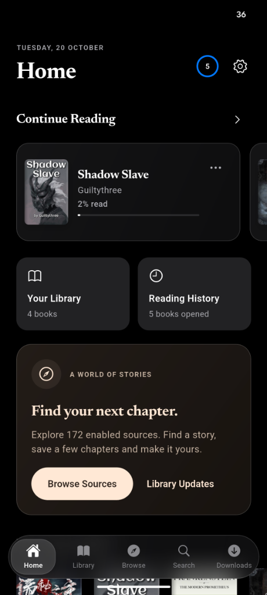
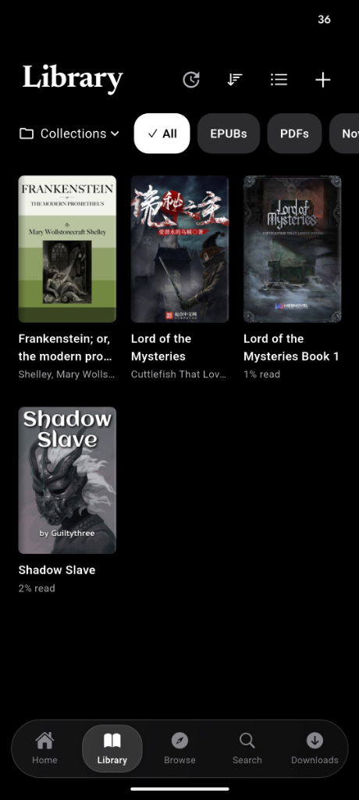
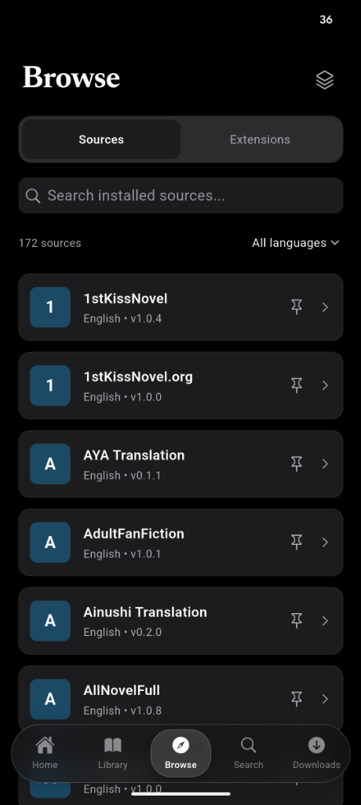
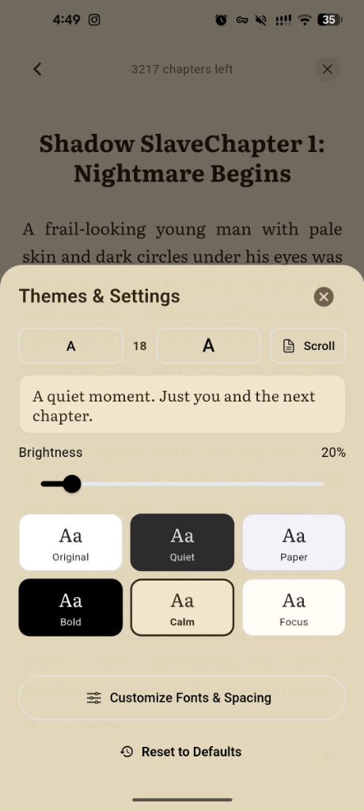
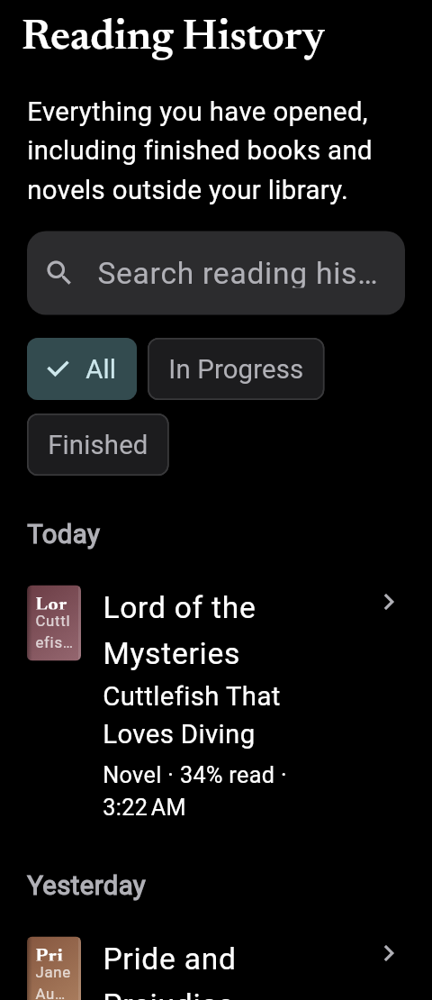
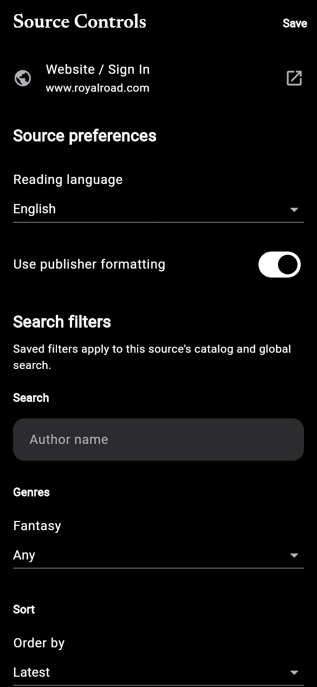
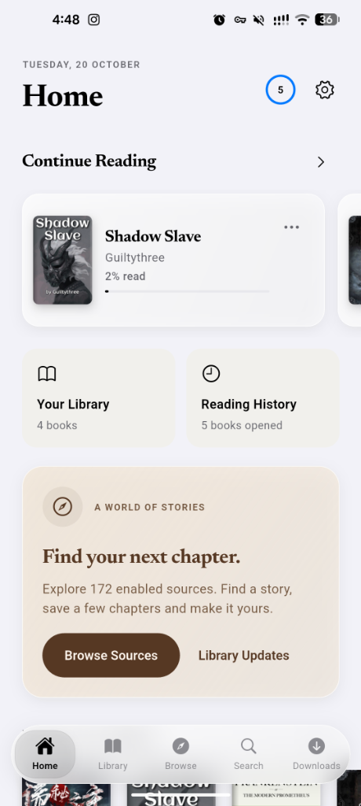

<div align="center">

  

  # 本 · Hon

  <p align="center">
    <strong>A quiet, elegant reading sanctuary for Android.</strong><br>
    <em>Crafted for online web novels, EPUBs, and PDFs — inspired by the craft and timeless typography of Apple Books.</em>
  </p>

  <p align="center">
    <a href="https://github.com/Khabi005/Hon/releases"></a>
    <a href="https://discord.gg/w2XsFwFTW"></a>
    
    
    
    
  </p>

  <p align="center">
    <a href="#-download--latest-release"><strong>📥 Download APK</strong></a> •
    <a href="#-community--discord"><strong>💬 Discord Community</strong></a> •
    <a href="#-features"><strong>✨ Features</strong></a> •
    <a href="#-interface-gallery-dark-theme"><strong>📱 Screenshots</strong></a> •
    <a href="#-typography--craft"><strong>📖 Typography</strong></a> •
    <a href="#-building-from-source"><strong>🛠️ Building</strong></a>
  </p>

</div>

---

> [!WARNING]
> ### 🚧 Active Work in Progress (WIP)
> **Hon is currently in active early development.** While the reader engine, native Kotlin novel source runtime, and background download pipelines are fully functional, you may encounter occasional visual polish items or in-flight features.
>
> Your feedback directly shapes Hon's direction! Join discussions, report issues, and suggest features in our **[Discord Server](https://discord.gg/w2XsFwFTW)**.

---

## 📥 Download & Latest Release

You can install Hon directly onto any Android device running Android 8.0 (API level 26) or newer.

### 🌟 Current Version: `v0.0.2` (Alpha WIP)

| Package | Architecture | Size | Recommendation |
|:---|:---:|:---:|:---|
| **[Hon-v0.0.2-arm64-v8a.apk](https://github.com/Khabi005/Hon/releases/tag/v0.0.2)** | `arm64-v8a` | **~30 MB** | **Recommended for almost all modern phones & tablets.** Leaner package and optimized native binaries. |
| **[Hon-v0.0.2-complete.apk](https://github.com/Khabi005/Hon/releases/tag/v0.0.2)** | Universal (All ABIs) | **~72 MB** | Contains native engines for `arm64`, `armeabi-v7a`, and `x86_64`. Best for older hardware or emulators. |

👉 **Check all release notes and assets on the [Releases Page](https://github.com/Khabi005/Hon/releases).**

#### Quick Installation
1. Download your preferred APK from the [latest release](https://github.com/Khabi005/Hon/releases).
2. Open the downloaded file on your Android device.
3. If prompted, allow your browser or file manager to *“Install unknown apps”*.
4. Launch Hon and start reading!

---

## 💬 Community & Discord

Have an idea for a feature? Want a specific novel source added? Encountered a bug? Or just want to talk about good books?

<div align="center">

[](https://discord.gg/w2XsFwFTW)

**Invite Link:** [https://discord.gg/w2XsFwFTW](https://discord.gg/w2XsFwFTW)

</div>

### In the Discord community, you can:
* 💡 **Propose Suggestions**: Discuss new features, reader controls, and UI improvements directly with the developer.
* 📚 **Source & Extension Requests**: Share, test, and discuss compatible Shosetsu novel extensions.
* 🐛 **Alpha Testing**: Get early preview test builds before public releases and share feedback.
* 🎨 **Themes & Typography**: Share your favorite font pairings, custom palettes, and reading layouts.

---

## 📱 Interface Gallery (Dark Theme)

<div align="center">

| Home & Reading Shelf | Library & Book Collections |
|:---:|:---:|
|  |  |

| Novel Sources & Catalog | Reader Themes & Settings |
|:---:|:---:|
|  |  |

| Reading History & Analytics | Source Controls & Sandbox |
|:---:|:---:|
|  |  |

<details>
<summary>☀️ <em>View Light Mode Home Preview</em></summary>
<br>

</details>

</div>

---

## ✨ Features

### 📖 Timeless Reading Experience
* **Apple Books Aesthetics**: Clean, calm, card-based shelf navigation with smooth glass surfaces and unobtrusive controls.
* **Instant Reader Controls**: Quick-access bottom sheet with live font scaling, margins, line spacing, and paragraph indentation.
* **Curated Themes**: Switch seamlessly between six master color schemes:
  * ☀️ **Original** — Crisp, standard clean white.
  * 🌿 **Quiet** — Soft muted tones for daytime leisure.
  * 📜 **Paper** — Warm, sepia-toned classic book paper.
  * 🌑 **Bold** — True deep black for OLED displays.
  * 🌊 **Calm** — Soothing dark slate for late-night reading.
  * 🎯 **Focus** — High-contrast minimal palette.
* **Bundled Premium Typefaces**: Includes *Libre Baskerville*, *Literata*, *Lora*, and *Newsreader*, alongside Android system fonts.
* **Reading Modes**: Continuous vertical scrolling and paginated reading.

### 🌐 Shosetsu Novel Ecosystem
* **Native Kotlin Engine**: Powered by an embedded native Luaj host, Jsoup HTML parser, and an asynchronous MethodChannel bridge.
* **170+ Bundled Sources**: Immediate access to extensive popular web novel catalogs without manual setup.
* **Extension Repositories**: Subscribe to custom extension repository URLs with automated index synchronization.
* **Source Settings & Login**: In-app WebKit login activity to bypass Cloudflare and authenticate with membership-required sources.

### ⚡ Industrial Background Downloads
* **Android WorkManager**: True system-managed background downloads that resume automatically across app kills and phone reboots.
* **Offline Chapter Images**: Downloads and caches chapter illustrations locally for complete offline immersion.
* **Non-Intrusive Library Policy**: Downloading a novel prompts to add it to your library, but lets you download without saving if you prefer.
* **Batch Operations**: Pause, resume, retry, or clear chapter queues effortlessly.

### 📚 Local Library & Document Management
* **Multi-Format Support**: Web novels, local EPUBs, and local PDFs in a unified library.
* **Collections & Shelves**: Organize your books into custom collections with intuitive drag-and-drop sorting.
* **Reading Analytics**: Reading streaks, weekly goals, chapter progress tracking, and detailed reading history.
* **Local-First & Private**: Zero user tracking, no accounts required, no telemetry. Full database backup and JSON restore.

---

## 📖 Typography & Craft

> *"A book is not just text on a screen; it is whitespace, rhythm, and peace of mind. Hon is crafted to disappear while you read."*

Hon pays deep attention to typographical detail:
* **Optical Sizing**: Tailored kerning and line-height curves calculated dynamically based on font size.
* **Paragraph Indentation**: Elegant first-line indentation that relaxes into standard block paragraphs for dialogue and poetry.
* **Subtle Chapter Ornaments**: Tasteful dividers and chapter headings inspired by traditional print literature.
* **Comfortable Margins**: Adaptive viewport padding tuned specifically for one-handed phone reading and expansive tablet displays.

---

## 🛠️ Architecture & Tech Stack

```
Hon Architecture
├── Presentation Layer (Flutter / Dart)
│   ├── Riverpod State Management
│   ├── Cupertino & Material Hybrid Glass UI
│   └── Multi-format Reader Viewports (EPUB, PDF, Novel)
│
├── Native Services (Kotlin / Android)
│   ├── ShosetsuKotlinEngine (Luaj + Jsoup parsing)
│   ├── HonDownloadWorker (Android WorkManager background tasks)
│   ├── ReadiumReaderBridge (Native EPUB pagination & styling)
│   └── SourceLoginActivity (Secure WebKit session authentication)
│
└── Persistence Layer (Local-First)
    ├── SQLite / Drift Reactive Database
    ├── Offline Chapter Storage & Image Cache
    └── Portable JSON Backup & Restoration
```

---

## 🚀 Building from Source

### Prerequisites
1. **Flutter SDK**: `^3.11.0` or later ([flutter.dev](https://flutter.dev/docs/get-started/install))
2. **Android SDK**: Build tools 35.0.0+, compileSdkVersion 36, targetSdkVersion 35
3. **Java JDK**: JDK 17 or JDK 21

### Build Steps

1. **Clone the repository:**
   ```bash
   git clone git@github.com:Khabi005/Hon.git
   cd Hon
   ```

2. **Install Dart dependencies:**
   ```bash
   flutter pub get
   ```

3. **Run code generation (Drift database models):**
   ```bash
   dart run build_runner build --delete-conflicting-outputs
   ```

4. **Run test suite:**
   ```bash
   flutter test
   ```

5. **Build release APK:**
   ```bash
   flutter build apk --release
   ```
   The compiled APK will be located at:
   `build/app/outputs/flutter-apk/app-release.apk`

---

## 🤝 Contributing & Suggestions

Contributions, bug reports, and suggestions are warmly welcomed!

1. **Join Discussions**: Hop into the [Discord Server](https://discord.gg/w2XsFwFTW) to bounce ideas around.
2. **Report Issues**: Check existing [GitHub Issues](https://github.com/Khabi005/Hon/issues) or open a new one with detailed reproduction steps.
3. **Submit Pull Requests**: Fork the repository, create your feature branch, and submit a PR for review.

---

## 📄 License

Hon is distributed under the **GNU General Public License v3.0 (GPL-3.0)**. See [`LICENSE`](LICENSE) for details.

---

<div align="center">
  <sub>Hon is independently developed with ❤️ for passionate readers everywhere.</sub>
</div>
